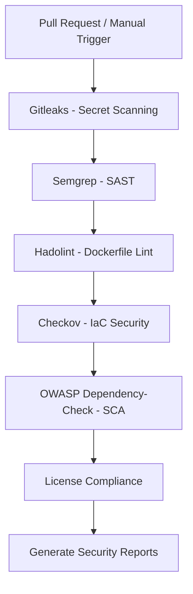

# 🔐 DevSecOps – Automated Security Pipeline

An automated DevSecOps pipeline built with **GitHub Actions** to continuously identify security vulnerabilities, exposed secrets, insecure configurations, dependency risks, and license compliance issues throughout the software development lifecycle.

## 🚀 Security Workflow

The pipeline is automatically triggered by:
- Manual execution (`workflow_dispatch`)
- Pull requests targeting the `dev` branch
- Pull request events: `opened`, `reopened`, `synchronize`, and `ready_for_review`

## 🛡️ Security Scanning Components

| Stage | Tool | Purpose |
|---|---|---|
| 1. Secret Scanning | Gitleaks | Detect exposed credentials, API keys, and sensitive information. |
| 2. SAST | Semgrep | Identify insecure coding practices and potential vulnerabilities. |
| 3. Dockerfile Lint | Hadolint | Detect Dockerfile misconfigurations and security issues. |
| 4. IaC Scanning | Checkov | Analyze Dockerfile and Docker Compose configurations. |
| 5. SCA | OWASP Dependency-Check | Identify vulnerable third-party dependencies. |
| 6. License Compliance | dotnet-project-licenses | Analyze third-party package licenses and generate compliance reports. |

## ⚙️ Pipeline Execution Flow

## 📊 Security Reports

The pipeline generates downloadable GitHub Actions artifacts:

- **Dependency Check Report:** HTML vulnerability assessment.
- **License Compliance Report:** Third-party dependency license information.

Reports are uploaded even when the corresponding scanning step fails, where supported by the workflow configuration.

## 🔑 Required GitHub Secrets

Configure the following secrets under:

`Repository → Settings → Secrets and variables → Actions`

| Secret | Description |
|---|---|
| `DEV_EXPRESS_KEY` | DevExpress NuGet package access key. |
| `NUGET_JTRB_SOURCE` | GitHub Packages repository owner or source identifier. |
| `NUGET_JTRB_USERNAME` | GitHub Packages authentication username. |
| `NUGET_JTRB_TOKEN` | GitHub Packages access token. |

**Security Note:** Protect credentials using GitHub Secrets, least-privilege permissions, and isolated trusted workflows. Avoid exposing credentials in logs or storing them unnecessarily in plaintext.

## 🧰 Technology Stack

- GitHub Actions
- Gitleaks
- Semgrep
- Hadolint
- Checkov
- OWASP Dependency-Check
- .NET 10
- NuGet
- Java

## 🎯 Security Objectives

- Prevent accidental exposure of sensitive credentials.
- Identify security vulnerabilities before deployment.
- Improve secure coding practices.
- Detect vulnerable third-party dependencies.
- Enforce infrastructure and container security standards.
- Improve open-source license compliance.
- Strengthen application security throughout the SDLC.

## 🔒 Security Best Practices

- Pin third-party GitHub Actions to verified commit SHAs.
- Apply least-privilege GitHub Actions permissions.
- Separate untrusted pull request scanning from private package authentication.
- Restrict access and retention of security report artifacts.
- Regularly update scanning tools and vulnerability databases.
- Never expose production credentials in CI/CD workflows.

---

**DevSecOps | Shift Security Left | Secure by Design** 🔐
